# Projeto - Cidades ESGInteligentes

**Orbital SOS API**: API REST em .NET 8 que conecta vítimas de desastres climáticos a abrigos, alertas de risco e doações.
É a solução do pilar **Social e Ambiental (ESG)** do projeto *Cidades ESGInteligentes*. Este repositório entrega a parte de
**DevOps**: containerização com Docker, orquestração com Docker Compose, pipeline CI/CD no GitHub Actions e deploy automatizado
em dois ambientes na nuvem (**staging** e **produção**).

| Ambiente | URL | Branch | Deploy |
|---|---|---|---|
| Staging | <https://orbital-sos-api-staging.onrender.com/swagger> | `develop` | automático a cada merge |
| Produção | <https://orbital-sos-api-prod.onrender.com/swagger> | `main` | depois de aprovação manual |

Estrutura do repositório:

```
orbital-sos-api/
├── src/
│   ├── OrbitalSOS.API/             Controllers, Program.cs, health check, appsettings por ambiente
│   ├── OrbitalSOS.Application/     DTOs, Services, Interfaces
│   ├── OrbitalSOS.Domain/          Entities, Enums
│   └── OrbitalSOS.Infrastructure/  DbContext, Repositories, Migrations, AdminSeeder
├── tests/OrbitalSOS.Tests/         Testes de integração xUnit (WebApplicationFactory + EF InMemory)
├── .github/workflows/ci-cd.yml     Pipeline CI/CD
├── Dockerfile / .dockerignore      Imagem da API
├── docker-compose*.yml             Ambiente local + simulação de staging e produção
├── .env.example                    Modelo de variáveis (o .env real não é versionado)
├── render.yaml                     Infraestrutura dos ambientes no Render (Blueprint)
├── scripts/                        Smoke test e empacotamento da entrega
└── docs/                           Documentação técnica, runbook de deploy e evidências
```

## Como executar localmente com Docker

**Pré-requisitos:** Docker Desktop (ou OrbStack) com Docker Compose v2.24 ou mais recente. As imagens da API e do PostgreSQL
rodam nativamente em x86_64 e em ARM (Mac Apple Silicon).

```bash
git clone https://github.com/vsilva1997/orbital-sos-api.git
cd orbital-sos-api
cp .env.example .env          # troque as senhas e a chave JWT
docker compose up -d --build  # sobe PostgreSQL + API (a API espera o banco ficar healthy)
docker compose ps             # os dois serviços devem aparecer como "healthy"
```

| O quê | Endereço |
|---|---|
| Swagger | <http://localhost:8080/swagger> |
| Health check | <http://localhost:8080/health> |
| PostgreSQL | `localhost:5432` (banco e usuário `orbitalsos`, senha do `.env`) |

Teste rápido de ponta a ponta (requer `curl` e `jq`). Ele cobre health, swagger, register, login, endpoint protegido e o login do admin:

```bash
set -a; source .env; set +a; scripts/smoke-test.sh http://localhost:8080 "" --full
```

Para parar: `docker compose down` mantém os dados no volume; `docker compose down -v` apaga o banco.

### Simular staging e produção localmente

Cada ambiente usa um projeto Compose próprio, com volume, porta e `ASPNETCORE_ENVIRONMENT` separados:

| Ambiente | Comando | Swagger |
|---|---|---|
| Development | `docker compose up -d --build` | <http://localhost:8080/swagger> |
| Staging | `docker compose -f docker-compose.yml -f docker-compose.staging.yml up -d --build` | <http://localhost:8081/swagger> |
| Produção (imagem do GHCR) | `IMAGE_TAG=<sha> docker compose -f docker-compose.yml -f docker-compose.prod.yml up -d` | <http://localhost:8082/swagger> |

### Variáveis de ambiente (`.env`)

| Variável | Uso |
|---|---|
| `ASPNETCORE_ENVIRONMENT` | `Development`, `Staging` ou `Production` (carrega `appsettings.<Ambiente>.json`) |
| `POSTGRES_DB`, `POSTGRES_USER`, `POSTGRES_PASSWORD` | Banco local. Viram `ConnectionStrings__DefaultConnection` da API |
| `JWT_KEY` | Chave de assinatura do JWT, com no mínimo 32 caracteres. Vira `Jwt__Key` |
| `ADMIN_EMAIL` / `ADMIN_PASSWORD` | Administrador inicial, criado na primeira inicialização (opcional) |
| `API_PORT`, `DB_PORT`, `DB_NAME`, `APP_VERSION` | Portas no host, nome do banco e versão exibida no `/health` |

Os segredos nunca ficam no código. A API lê `ConnectionStrings__DefaultConnection` e `Jwt__Key` do ambiente e não inicia sem eles.

### Testes automatizados (sem Docker)

```bash
dotnet test
```

São 14 testes de integração. Eles sobem a API em memória com `WebApplicationFactory` e banco EF InMemory, então não precisam de banco externo.

### Endpoints principais

| Método | Rota | Auth |
|--------|------|------|
| GET | /health | — |
| POST | /api/auth/register | — (sempre cria perfil `Usuario`) |
| POST | /api/auth/login | — |
| GET | /api/shelters | — |
| POST | /api/shelters | Admin/Operador |
| GET | /api/climatealerts | — |
| POST | /api/climatealerts | Admin/Operador |
| GET | /api/riskareas | — |
| GET | /api/sosrequests | Autenticado |
| POST | /api/sosrequests | Autenticado |
| PATCH | /api/sosrequests/{id}/status | Admin/Operador |
| GET | /api/donations | — |
| POST | /api/donations | Autenticado |
| GET | /api/donations/shelter/{id}/balance | — |

### Fluxo de autenticação

1. `POST /api/auth/register` cria um usuário comum (`Usuario`) e devolve o token. O campo `role` do corpo é ignorado.
2. Para rotas de Admin/Operador, faça `POST /api/auth/login` com o administrador inicial (`ADMIN_EMAIL` / `ADMIN_PASSWORD`).
3. Copie o `token` da resposta. No Swagger, clique em **Authorize** e informe `Bearer {token}`.
4. A coleção do Postman (`OrbitalSOS_Postman.json`) usa as variáveis `{{baseUrl}}`, `{{adminEmail}}` e `{{adminPassword}}`.

## Pipeline CI/CD

**Ferramenta:** GitHub Actions ([`.github/workflows/ci-cd.yml`](.github/workflows/ci-cd.yml)). A imagem fica no GitHub Container
Registry (GHCR) e os ambientes rodam no Render, com banco PostgreSQL no Supabase.

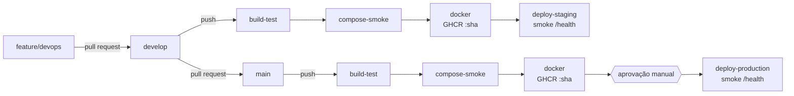

| Job | Quando roda | O que faz |
|---|---|---|
| `build-test` | PR e push em `develop`/`main` | `setup-dotnet` 8 com cache do NuGet, `dotnet restore --locked-mode`, `dotnet build -c Release`, `dotnet test` com logger trx (artefato `test-results` e tabela no resumo do job) e checagem de pacotes vulneráveis |
| `compose-smoke` | PR e push | Valida os três arquivos Compose, sobe API + PostgreSQL com segredos efêmeros e roda o smoke test completo |
| `docker` | só em push (nunca em PR) | Build com Buildx (cache GHA) e push de `ghcr.io/vsilva1997/orbital-sos-api:<sha>` e `:<branch>` |
| `deploy-staging` | push em `develop` | Environment `staging`: chama o deploy hook do Render com a imagem do SHA e espera o `/health` responder `Healthy` nessa versão (retry de até 10 min) |
| `deploy-production` | push em `main` | Environment `production`: **aprovação manual obrigatória**, depois o mesmo deploy e smoke test |

**Lógica:**
- Toda mudança entra por pull request. O PR só valida (build, testes, Compose) e não publica nada.
- Depois do merge, a imagem é gerada uma vez por commit e identificada pelo SHA. O mesmo SHA vai para o `/health` (`version`), o que permite ao smoke test confirmar que a versão nova está no ar.
- Os environments do GitHub isolam os segredos de cada ambiente: `staging` só aceita a branch `develop` e `production` só aceita `main`, com revisor obrigatório.

| Configuração no GitHub | Tipo | Onde |
|---|---|---|
| `RENDER_DEPLOY_HOOK_URL` | secret | environments `staging` e `production` |
| `STAGING_URL`, `PRODUCTION_URL` | variáveis do repositório | link dos environments, smoke test e health check diário |
| `GITHUB_TOKEN` | automático | push no GHCR (`packages: write` só no job `docker`) |

Os segredos de runtime ficam nas variáveis de cada serviço no Render:
- `ConnectionStrings__DefaultConnection`, com a connection string do Supabase (usuário e schema do ambiente);
- `Jwt__Key`, gerada pelo próprio Render;
- `Admin__Email` e `Admin__Password`.

Passo a passo da configuração da nuvem: [`docs/deploy-render-supabase.md`](docs/deploy-render-supabase.md).

## Containerização

Conteúdo do [`Dockerfile`](Dockerfile):

```dockerfile
# syntax=docker/dockerfile:1

# ---------- Estágio 1: build (SDK completo, descartado no final) ----------
FROM mcr.microsoft.com/dotnet/sdk:8.0 AS build
WORKDIR /src

# Restore em camada própria: só roda de novo quando um .csproj ou lock file muda
COPY Directory.Build.props ./
COPY src/OrbitalSOS.Domain/OrbitalSOS.Domain.csproj src/OrbitalSOS.Domain/packages.lock.json src/OrbitalSOS.Domain/
COPY src/OrbitalSOS.Infrastructure/OrbitalSOS.Infrastructure.csproj src/OrbitalSOS.Infrastructure/packages.lock.json src/OrbitalSOS.Infrastructure/
COPY src/OrbitalSOS.Application/OrbitalSOS.Application.csproj src/OrbitalSOS.Application/packages.lock.json src/OrbitalSOS.Application/
COPY src/OrbitalSOS.API/OrbitalSOS.API.csproj src/OrbitalSOS.API/packages.lock.json src/OrbitalSOS.API/
RUN dotnet restore src/OrbitalSOS.API/OrbitalSOS.API.csproj --locked-mode

# Código-fonte e publish em Release
COPY src/ src/
RUN dotnet publish src/OrbitalSOS.API/OrbitalSOS.API.csproj -c Release -o /app/publish --no-restore -p:UseAppHost=false

# ---------- Estágio 2: runtime (só o ASP.NET Core runtime) ----------
FROM mcr.microsoft.com/dotnet/aspnet:8.0 AS runtime

# curl apenas para o HEALTHCHECK (a imagem aspnet não traz curl)
RUN apt-get update \
    && apt-get install -y --no-install-recommends curl \
    && rm -rf /var/lib/apt/lists/*

WORKDIR /app
COPY --from=build /app/publish .

# Porta 8080 (padrão do .NET 8 para usuário não root); ambiente padrão Production
ENV ASPNETCORE_HTTP_PORTS=8080 \
    ASPNETCORE_ENVIRONMENT=Production
EXPOSE 8080

# Versão (SHA do commit) injetada pelo pipeline e exibida em /health
ARG APP_VERSION=dev
ENV APP_VERSION=$APP_VERSION

# Usuário não root que já existe nas imagens .NET 8
USER app

HEALTHCHECK --interval=30s --timeout=5s --start-period=60s --retries=3 \
    CMD curl -fsS http://localhost:8080/health || exit 1

ENTRYPOINT ["dotnet", "OrbitalSOS.API.dll"]
```

**Escolhas e por quê:**
- **Multi-stage (`sdk:8.0` → `aspnet:8.0`).** O SDK, de cerca de 800 MB, só existe no estágio de build. A imagem final leva apenas o runtime e o resultado do `publish`, o que a deixa menor e com menos superfície de ataque.
- **Restore em camada separada.** Primeiro entram só os `.csproj` e os `packages.lock.json`. Assim, uma mudança de código não refaz o download dos pacotes NuGet. O `--locked-mode` garante as mesmas versões do CI.
- **Usuário não root (`USER app`) e porta 8080.** Esse é o padrão das imagens .NET 8: sem privilégio de root, a aplicação não consegue escutar em portas abaixo de 1024, por isso usa a 8080 em vez da 80.
- **HEALTHCHECK com `curl` em `/health`.** A imagem `aspnet` não traz `curl`, então ele é instalado sem pacotes recomendados e com o cache do apt limpo. O `/health` também testa a conexão com o banco, e o Docker marca o container como `unhealthy` se a API ou o banco caírem.
- **`APP_VERSION` como build-arg.** O pipeline injeta o SHA do commit, que aparece no `/health`. É assim que o smoke test confirma qual versão está rodando.
- **[`.dockerignore`](.dockerignore).** Mantém fora do contexto de build `bin/`, `obj/`, `.git/`, `.env`, `tests/`, `docs/` e `scripts/`: o build fica mais rápido e nenhum segredo vai para a imagem.

**Arquitetura do [`docker-compose.yml`](docker-compose.yml):**

| Recurso | Configuração |
|---|---|
| Serviço `db` | `postgres:17-alpine` (mesma versão major do Supabase), `POSTGRES_PASSWORD` vinda do `.env`, porta publicada só em `127.0.0.1` |
| Health check do banco | `pg_isready -U $POSTGRES_USER -d $POSTGRES_DB` a cada 5 s |
| Serviço `api` | Build do `Dockerfile` (ou imagem do GHCR em `docker-compose.prod.yml`), `depends_on: db: condition: service_healthy` |
| Volume nomeado | `pg-data` em `/var/lib/postgresql/data`: os dados sobrevivem ao `docker compose down` |
| Rede dedicada | `orbital-net` (bridge): a API acessa o banco pelo nome `db`, sem expor o banco para fora |
| Variáveis | Todas vêm do `.env` (modelo em `.env.example`). Os segredos obrigatórios usam `${VAR:?mensagem}` e falham cedo se faltarem |

**Imagem gerada:** `ghcr.io/vsilva1997/orbital-sos-api`. As tags são:
- `:<sha-do-commit>`, imutável e usada no deploy;
- `:develop` e `:main`, que apontam para o último build de cada branch.

**Comandos usados:**

```bash
docker build -t orbital-sos-api:local --build-arg APP_VERSION=local .
docker run --rm -p 8080:8080 -e ConnectionStrings__DefaultConnection="..." -e Jwt__Key="..." orbital-sos-api:local
docker compose up -d --build
docker compose ps
docker compose logs -f api
docker compose down -v
docker pull ghcr.io/vsilva1997/orbital-sos-api:main
```

## Prints do funcionamento

- **Staging:** <https://orbital-sos-api-staging.onrender.com/swagger> · [/health](https://orbital-sos-api-staging.onrender.com/health)
- **Produção:** <https://orbital-sos-api-prod.onrender.com/swagger> · [/health](https://orbital-sos-api-prod.onrender.com/health)
- **Pipeline:** <https://github.com/vsilva1997/orbital-sos-api/actions>

> Os serviços Free do Render dormem depois de 15 minutos sem uso. O primeiro acesso pode levar até 1 minuto.

As imagens ficam em [`docs/evidencias/`](docs/evidencias/), e a lista do que cada print deve mostrar está em
[`docs/evidencias/README.md`](docs/evidencias/README.md).

### Pipeline

| PR validado (build, testes e compose) | Pipeline da `develop` até staging |
|---|---|
| 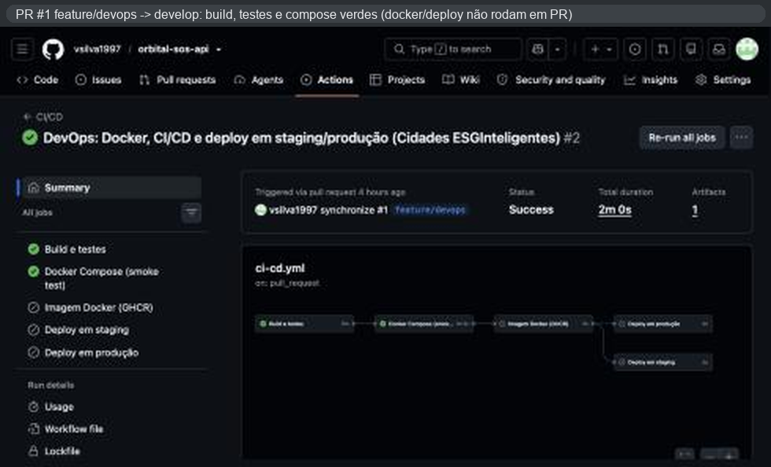 | 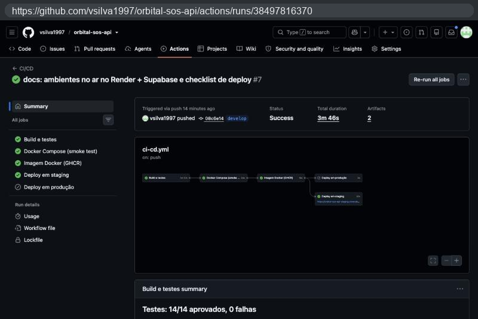 |
| **Resultado dos testes (14/14)** | **Docker Compose no CI (smoke test)** |
| 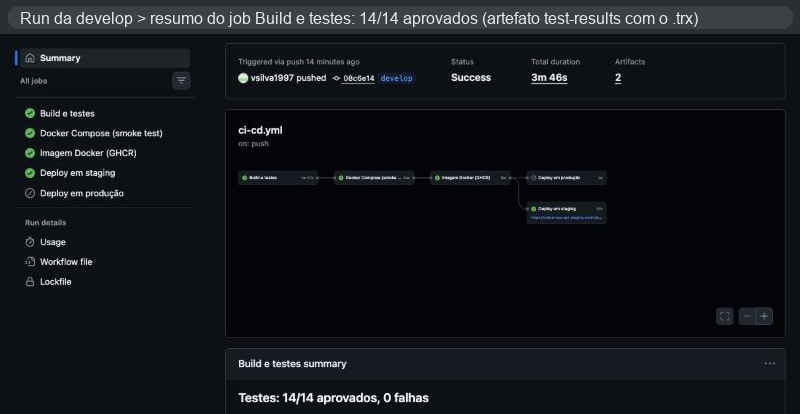 | 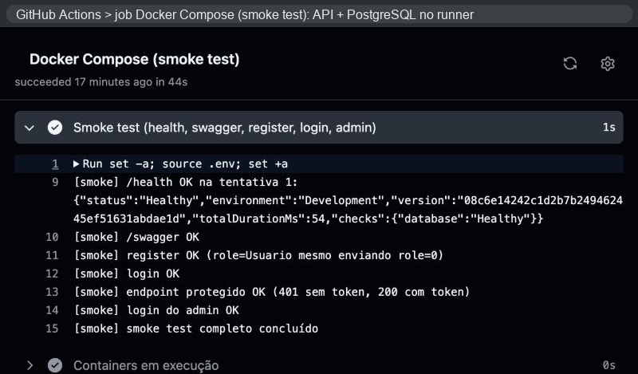 |
| **Imagem no GHCR** | **Aprovação manual de produção** |
| 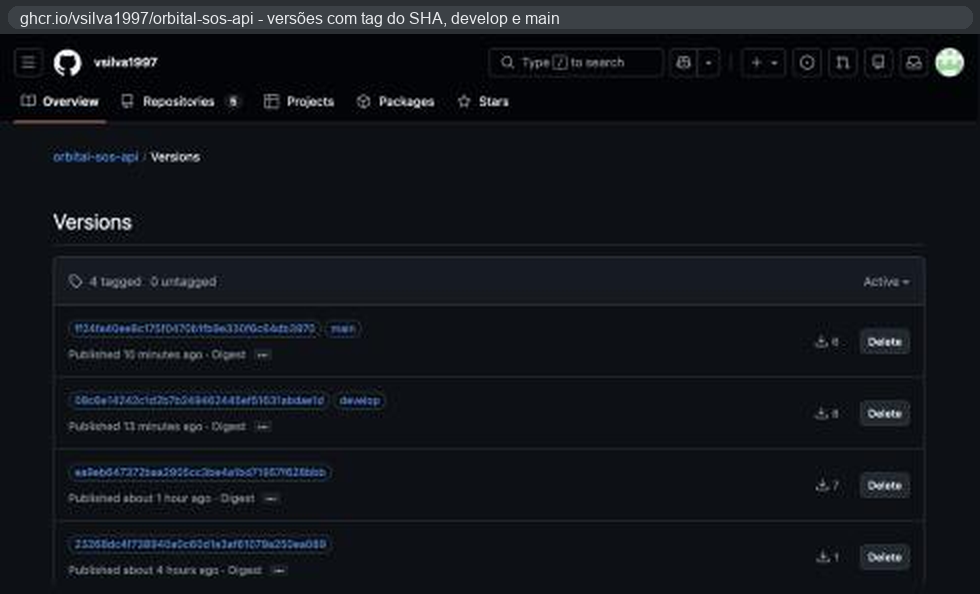 | 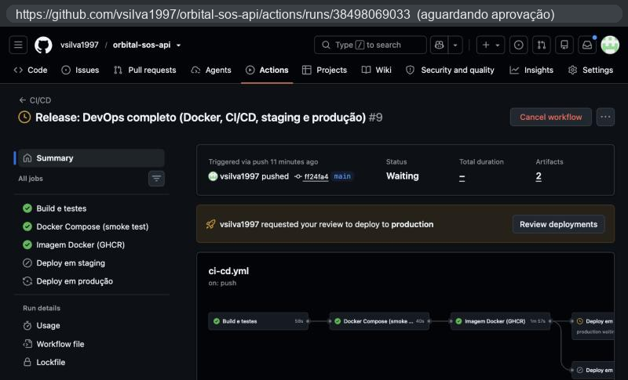 |
| **Pipeline da `main` até produção** | **Environments e regras de proteção** |
| 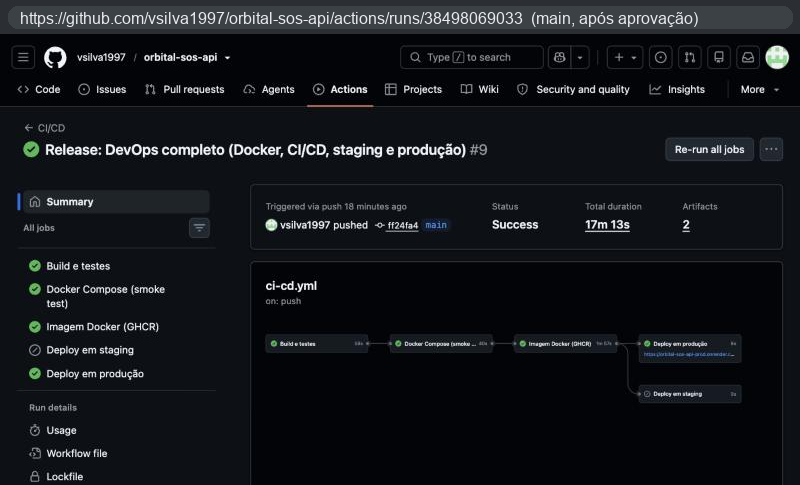 | 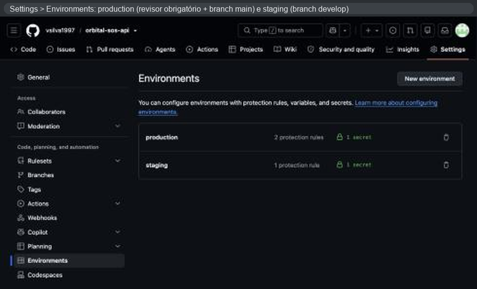 |

### Ambientes funcionando

| Staging: `/health` | Staging: Swagger |
|---|---|
| 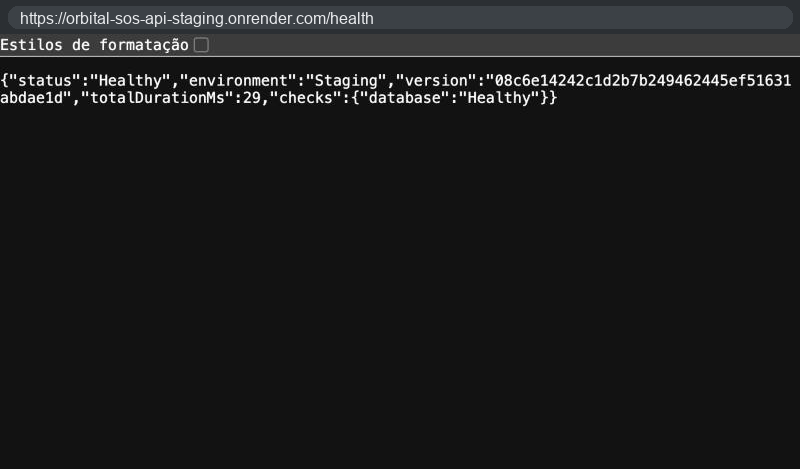 | 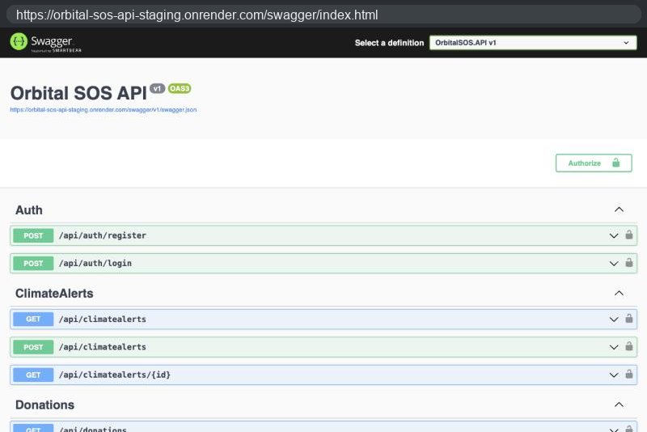 |
| **Produção: `/health`** | **Produção: register e login no Swagger** |
| 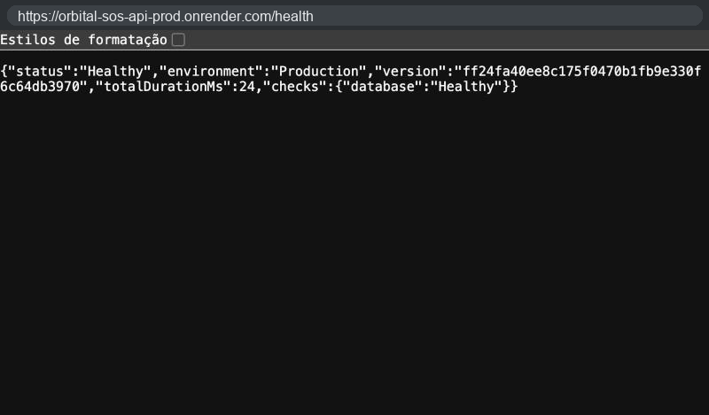 | 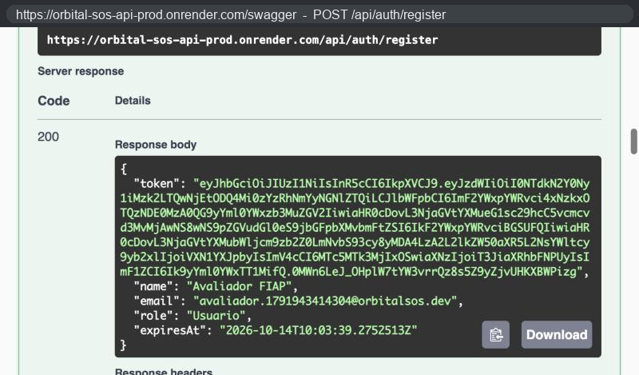 |
| **Render: os dois serviços no ar** | **Supabase: schemas de staging e produção** |
| 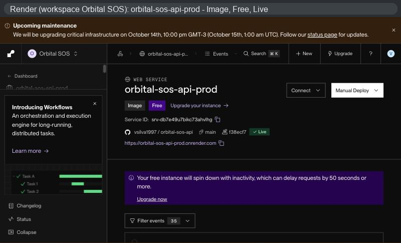 | 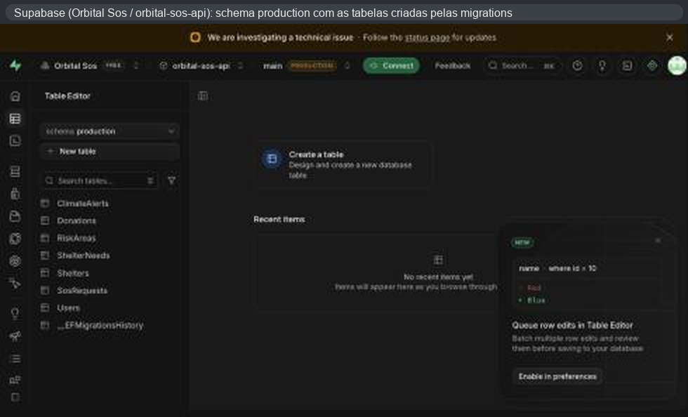 |

## Tecnologias utilizadas

| Camada | Tecnologias |
|---|---|
| API | .NET 8, ASP.NET Core Web API, Clean Architecture (API / Application / Domain / Infrastructure) |
| Dados | Entity Framework Core 8 com Npgsql, PostgreSQL 17 (local, em container) e Supabase (nuvem, um schema por ambiente) |
| Segurança | JWT Bearer, BCrypt, segredos por variáveis de ambiente, GitHub Environments com aprovação manual |
| Observabilidade | Health checks do ASP.NET Core (`/health` com verificação do banco), Swagger/OpenAPI |
| Testes | xUnit, `WebApplicationFactory`, EF Core InMemory, smoke test em bash (`curl` + `jq`) |
| Containers | Docker (multi-stage, não root), Docker Compose, GitHub Container Registry (GHCR) |
| CI/CD | GitHub Actions (setup-dotnet, Buildx, metadata/build-push), actionlint |
| Nuvem | Render (Web Services com imagem Docker, Blueprint `render.yaml`), Supabase (PostgreSQL gerenciado, plano Free) |

## Checklist de entrega

| Item | OK |
|---|---|
| Projeto compactado em .ZIP com estrutura organizada | ☑ `scripts/empacotar.sh` ou `scripts/empacotar.ps1` geram `entrega.zip` |
| Dockerfile funcional | ☑ build validado no pipeline (job `compose-smoke` e `docker`) |
| docker-compose.yml ou arquivos Kubernetes | ☑ `docker-compose.yml` + overrides de staging e prod |
| Pipeline com etapas de build, teste e deploy | ☑ `.github/workflows/ci-cd.yml` |
| README.md com instruções e prints | ☐ instruções prontas; faltam os prints em `docs/evidencias/` |
| Documentação técnica com evidências (PDF ou PPT) | ☐ `docs/Documentacao_DevOps.pptx`; faltam os prints e os integrantes |
| Deploy realizado nos ambientes staging e produção | ☐ aguardando a configuração do Render e do Supabase |
